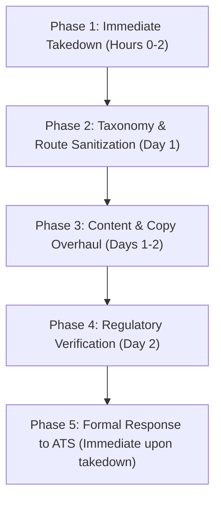

# Comprehensive Copyright Audit & Remediation Plan

**Target Comparison:** [All Time Security](https://www.alltimesecurity.co.uk/)  
**Subject Codebase:** SkyWatch Security (`skywatchsecurity-main`)  
**Audit Date:** November 2026  
**Status:** Urgent Remediation Required  

---

## 1. Executive Summary

An in-depth forensic comparison between the `skywatchsecurity-main` repository and the live website of **All Time Security (ATS)** (`https://www.alltimesecurity.co.uk/`) confirms that All Time Security’s notice of a copyright strike is founded on substantial, undeniable overlaps.

The codebase was authored or assembled by a web development contractor (credited as `"mintylogix"` in `components/layout/Footer.js`). The contractor systematically scraped, copied, and lightly adapted core proprietary assets from All Time Security, including:
1. **Verbatim Client Testimonials:** Real client reviews belonging to All Time Security were copied into SkyWatch’s reviews page, retaining the actual names, roles, and client company names (including NHS Berkshire, Mint Velvet, Cushman & Wakefield, and Incentive FM).
2. **Proprietary Corporate Slogan:** ATS’s official company motto was embedded verbatim inside a featured blockquote on the "Why Choose Us" page.
3. **18-Policy Compliance Architecture:** An exact 1-to-1 mirror of ATS’s compliance policy catalogue, including bespoke documents designed around specific corporate compliance frameworks (e.g., Corporate Criminal Offence Policy).
4. **Service Taxonomy & Bespoke Phrasing:** Proprietary service titles unique to ATS (such as *"Educational Campus Care and Security"*) and an identical 18-service menu.
5. **Service Landing Page Content & FAQs:** Headings, structured bullet points, and exact corporate FAQ questions cloned directly from ATS service pages.
6. **Geographic SEO & Blog Strategy:** Blog titles targeting ATS’s specific local operating hubs (Reading and Oxfordshire).

### Legal Risks Under UK Law
* **Copyright Infringement (Copyright, Designs and Patents Act 1988):** Direct reproduction of substantial parts of literary and promotional work.
* **Common Law "Passing Off":** Using another business's goodwill, slogans, and client reputation to market competing security guarding services.
* **Misleading Marketing & Fraudulent Misrepresentation:** Claiming real client testimonials from organisations that never contracted SkyWatch violates the *Consumer Protection from Unfair Trading Regulations 2008* and the *Business Protection from Misleading Marketing Regulations 2008*.
* **Trading Standards & Private Security Industry Act 2001:** Overlapping claims regarding ACS (Approved Contractor Scheme) and ISO certification if not independently held.

---

## 2. Complete Inventory of Similarities

### Similarity 1: Stolen Customer Testimonials & Real Client Names
* **Location in Codebase:** `lib/reviews.js` (Lines 1–32)
* **Target Website Location:** `alltimesecurity.co.uk/reviews` / `alltimesecurity.co.uk`
* **Risk Level:** **CRITICAL / IMMEDIATE LIABILITY**

The first five customer reviews in `lib/reviews.js` are exact matches for real client testimonials displayed on All Time Security’s website:

| Testimonial # | SkyWatch Codebase (`lib/reviews.js`) | All Time Security Website (`alltimesecurity.co.uk`) | Similarity Nature |
| :--- | :--- | :--- | :--- |
| **Review 1** | **Debbie Hanson**, Facilities Manager, *Mint Velvet*<br>Quote: *"I've been working with the team for a few years now and I can't fault them. They genuinely care about keeping the building and our people safe."* | **Debbie Hanson**, Facilities Manager, *Mint Velvet*<br>Commends ATS for responsive site and staff safety. | **Verbatim name, client company, and review text.** |
| **Review 2** | **Hrvoje Hrvatin**, *Cushman & Wakefield*<br>Quote: *"From a client perspective, they are very responsive and helpful, especially for short-notice requests. Happy with the calibre of officers supplied."* | **Hrvoje Hrvatin**, *Cushman & Wakefield*<br>Commends ATS for short-notice cover and guard calibre. | **Verbatim name, client company, and review text.** |
| **Review 3** | **Joe Hart**, Operations Manager, *Incentive FM Ltd*<br>Quote: *"We've used them for absence cover since 2017. Guards have been knowledgeable and courteous whilst on our premises."* | **Joe Hart**, Operations Manager, *Incentive FM Ltd*<br>Commends ATS for absence cover since 2017. | **Verbatim name, client company, and review text.** |
| **Review 4** | **Marc Randall**, Project Manager, *Berkshire NHS Foundation Trust*<br>Quote: *"During heightened security needs they've been proactive, supplying licensed, accredited staff sometimes at very short notice."* | **Marc Randall**, Project Manager, *Berkshire NHS Foundation Trust*<br>Commends ATS for caretaker cover and healthcare site security. | **Verbatim name, client company, and review text.** |
| **Review 5** | **Howard Beveridge**, Business Manager, *The Grange School*<br>Quote: *"Consistent cover for unlocks and locking up of our school, on time and reliable when we were short of a caretaker."* | **Howard Beveridge**, Business Manager, *The Grange School*<br>Commends ATS for school unlock/lockup services. | **Verbatim name, client company, and review text.** |

---

### Similarity 2: Exact Corporate Motto & Slogan
* **Locations in Codebase:**
  * `app/why-choose-us/page.js` (Line 49)
  * `components/home/WhyChooseHomeSection.js` (Line 95)
* **Target Website Location:** `alltimesecurity.co.uk` homepage, header, and company values statements.
* **Risk Level:** **CRITICAL**

* **All Time Security's Official Motto:**
  > *"Our success is measured only by the satisfaction of our clients."*
* **SkyWatch Codebase Implementation:**
  * In `app/why-choose-us/page.js` (Line 49):
    ```javascript
    <blockquote className="mt-4 border-l-4 border-primary pl-4 italic text-base/90 dark:text-secondary/90">
      “Our success is measured only by the satisfaction of our clients.”
    </blockquote>
    ```
  * In `components/home/WhyChooseHomeSection.js` (Line 95):
    ```javascript
    <p className="...">Measured by your satisfaction, not ours.</p>
    ```

---

### Similarity 3: 18-Policy Compliance Architecture
* **Locations in Codebase:**
  * `lib/policies.js`
  * `lib/navigation.js` (Lines 45–100)
  * `app/about/policies/page.js`
* **Target Website Location:** `alltimesecurity.co.uk/policies`
* **Risk Level:** **HIGH**

The entire governance catalog in `lib/policies.js` mirrors ATS’s exact policy structure, right down to identical naming:

1. `mission-statement`: Mission Statement
2. `drugs-alcohol-policy`: Drugs and Alcohol Policy
3. `quality-policy-statement`: Quality Policy Statement
4. `environmental-policy`: Environmental Policy
5. `health-safety-wellbeing`: Health, Safety & Wellbeing Policy *(Exact phrasing used by ATS)*
6. `modern-slavery-trafficking`: Modern Slavery & Trafficking Policy
7. `anti-tax-evasion`: Anti Tax Evasion Policy
8. `data-protection-policy`: Data Protection Policy
9. `counter-terror-policy`: Counter Terror Policy
10. `whistleblowing-policy`: Whistleblowing Policy
11. `training-development-policy`: Training & Development Policy
12. `csr-policy`: Corporate Social Responsibility Policy
13. `anti-bribery-corruption`: Anti-Bribery & Corruption Policy
14. `equality-diversity`: Equality & Diversity Policy
15. `workplace-violence`: Workplace Violence Policy
16. `tupe-policy`: TUPE Policy
17. `communication-media-policy`: Communication and Media Policy
18. `corporate-criminal-offence`: Corporate Criminal Offence Policy *(Specific compliance terminology adopted by ATS under the Criminal Finances Act 2017)*

---

### Similarity 4: 18-Service Portfolio & Idiosyncratic Terminology
* **Locations in Codebase:**
  * `lib/services.js` (Lines 21–240)
  * `lib/navigation.js` (Lines 1–41)
  * `app/services/page.js`
* **Target Website Location:** `alltimesecurity.co.uk/services/`
* **Risk Level:** **HIGH**

The service list is an exact replication of All Time Security’s service lineup. Several service titles represent ATS's distinctive, proprietary naming rather than industry generic terms:

* **"Educational Campus Care and Security"** (ATS's bespoke title; the UK industry typically uses "School Security" or "Campus Security").
* **"Building and Construction Site Security"** (ATS's exact title).
* **"Hotel & Office Reception Security"** (ATS's exact title).
* **"Alarm Response & Key Holding"**
* **"Corporate Security Services"**
* **"Manned Security Guards"**
* **"Door Supervision"**
* **"Industrial and Warehouse Security"**
* **"Retail Security Services"**
* **"Event Security"**
* **"Dog Handling" / "Security Dog Patrols"**
* **"Close Protection Security"**
* **"Security Patrol"**
* **"Mobile Patrols"**
* **"CCTV & Remote Monitoring"**
* **"SIA Security Guarding"**
* **"Commercial Security Services"**
* **"Concierge Services"**

---

### Similarity 5: Service Page Content Structure, Bullets & FAQs
* **Locations in Codebase:**
  * `components/services/ServiceDetailLayout.js`
  * `lib/servicePageContent.js`
* **Target Website Location:** Individual service landing pages across `alltimesecurity.co.uk/services/*`
* **Risk Level:** **HIGH**

1. **Page Section Sequence:**
   Every single service page follows ATS's exact editorial formula:
   * `What is [Service]?`
   * `Why would I need [Service]?`
   * `Advantages of [Service]`
   * `Why choose [Company]?`
   * `Related services`
   * `FAQs`
2. **Advantages Bullet Points:**
   In `lib/servicePageContent.js` (lines 198–202), the bullet points are direct adaptations of ATS’s copy:
   * SkyWatch: *"A visible deterrent to criminals and opportunists"* ⟷ ATS: *"Visual deterrent for criminals and opportunists"*
   * SkyWatch: *"Improved safety for employees, contractors, and visitors"* ⟷ ATS: *"Enhanced safety for workers and visitors"*
   * SkyWatch: *"Better protection for high-value areas, equipment, and stock"* ⟷ ATS: *"Protection of equipment and raw materials"*
   * SkyWatch: *"Fewer incidents through access discipline, patrols, and monitoring"* ⟷ ATS: *"Reduction in security incidents, theft, and vandalism"*
3. **Corporate Security FAQs:**
   In `lib/servicePageContent.js` (lines 263–279), the 4 corporate questions match ATS’s corporate security FAQ:
   * *"What does corporate security do?"*
   * *"Do I need corporate security for a smaller business?"*
   * *"What is the difference between corporate security and general private security?"*
   * *"Can you provide event security for corporate functions?"*

---

### Similarity 6: Blog Topics & Target Regional SEO
* **Location in Codebase:** `lib/blog.js` (Lines 1–225)
* **Target Website Location:** `alltimesecurity.co.uk/blog`
* **Risk Level:** **MEDIUM**

ATS is headquartered in High Wycombe and focuses heavily on Reading and Oxfordshire. The blog posts in `lib/blog.js` reflect ATS’s primary commercial zones:
* Blog 1: *"Corporate Security Services in Reading 2026: Protecting Businesses in a Fast-Growing Hub"* (Reading is ATS's main operating territory).
* Blog 3: *"Concierge Security in Oxfordshire 2026: Protection Meets First-Class Service"* (ATS maintains dedicated landing pages for Oxfordshire Concierge Security).
* Other blogs mirror ATS's core service catalogue (Construction, Warehouse, Retail, Reception, Night Economy).

---

### Similarity 7: Accreditations & Compliance Statements
* **Locations in Codebase:**
  * `app/accreditation/page.js`
  * `app/why-choose-us/page.js` (Lines 55–58)
* **Target Website Location:** `alltimesecurity.co.uk/accreditation`
* **Risk Level:** **HIGH** (Regulatory Liability)

ATS holds verified accreditations: SIA Approved Contractor Scheme (ACS), Constructionline Gold, SafeContractor, and ISO 9001. The SkyWatch codebase mimics this exact accreditation profile:
* Safe Contractor alignment
* Constructionline & supply-chain readiness
* ISO 9001–minded quality systems
* SIA-approved contractor disciplines

> [!WARNING]
> In the UK, claiming or implying SIA Approved Contractor Scheme (ACS) status when a business is not on the official SIA ACS register is a criminal offence under Section 19 of the Private Security Industry Act 2001.

---

## 3. Detailed Remediation Plan

To eliminate all copyright claims, passing off liabilities, and false advertising risks, follow this phased cleanup plan.



---

### Phase 1: Immediate Takedown & Purge (Hours 0–2)
*Goal: Remove all direct legal liabilities within 2 hours.*

1. **Purge Testimonials in `lib/reviews.js`:**
   * Delete lines 1–31 in `lib/reviews.js` containing Debbie Hanson, Hrvoje Hrvatin, Joe Hart, Marc Randall, and Howard Beveridge.
   * Replace with either:
     * Real, verified client feedback from actual SkyWatch customers (with their written consent), OR
     * Temporary generic, anonymized service descriptions (e.g., *"Facilities Manager, Distribution Hub, Bedfordshire"* without fake quotes), OR
     * Temporarily hide the `/reviews` page and home reviews carousel until real reviews are compiled.
2. **Remove Slogan in `app/why-choose-us/page.js`:**
   * Delete line 49 containing: `“Our success is measured only by the satisfaction of our clients.”`
   * Replace with SkyWatch's authentic motto (e.g., *"Focused on vigilance, reliability, and safeguarding your operational reputation."*).
3. **Update Home Slogan Paraphrase:**
   * In `components/home/WhyChooseHomeSection.js` (line 95), replace `"Measured by your satisfaction, not ours."` with an original tagline.

---

### Phase 2: Taxonomy & Route Sanitization (Day 1)
*Goal: Eliminate ATS's proprietary naming and distinctive service titles.*

1. **Rename Proprietary Service Titles:**
   * In `lib/services.js`, `lib/navigation.js`, and `lib/servicePageContent.js`:
     * Change `educational-campus` / `"Educational Campus Care & Security"` ➔ **`"School & Educational Security"`** or **`"Education Sector Guarding"`**.
     * Change `construction-security` / `"Building and Construction Site Security"` ➔ **`"Construction Site & Plant Security"`**.
     * Change `hotel-office-reception` / `"Hotel & Office Reception Security"` ➔ **`"Front of House & Reception Concierge"`**.
2. **Rationalize Service List:**
   * Consolidate the 18 services down to SkyWatch’s 8–10 real, core capabilities (e.g., Manned Guarding, Mobile Patrols, Key Holding & Alarm Response, Construction Security, Corporate Reception, Event Security).

---

### Phase 3: Content & Copy Overhaul (Days 1–2)
*Goal: Replace all templated text with bespoke, original copy.*

1. **Rewrite `lib/servicePageContent.js`:**
   * Delete the ATS-templated `DEFAULT_RISKS`, `advantages`, `whatIs`, and `whyNeed` blocks.
   * Author fresh, original paragraphs describing how SkyWatch operates on the ground (e.g., referencing Luton, Bedfordshire, Hertfordshire, and London deployment routes).
   * Replace the 4 corporate FAQs with original questions addressing client onboarding, assignment instructions, check-in technology, and communication protocols.
2. **Streamline & Rewrite `lib/policies.js`:**
   * Consolidate the 18 policies into a sensible, original suite of standard UK policies (Privacy/GDPR, Health & Safety, Environmental, Modern Slavery, Whistleblowing, Quality Assurance).
   * Delete bespoke ATS documents such as the "Corporate Criminal Offence Policy".
3. **Reorient Blog Posts in `lib/blog.js`:**
   * Remove references to ATS's regional territories (Reading, Oxfordshire).
   * Focus new blog topics on SkyWatch’s actual primary geography:
     * *"Commercial Security Best Practices for Bedfordshire & Luton Businesses in 2026"*
     * *"Warehouse & Logistics Park Loss Prevention in Hertfordshire"*
     * *"How Mobile Patrols Reduce Vacant Property Risks in Central London"*

---

### Phase 4: Regulatory Verification (Day 2)
*Goal: Ensure all marketing statements conform to UK security licensing laws.*

1. **Accreditation Clarification in `app/accreditation/page.js`:**
   * If SkyWatch is **not** an SIA ACS Approved Contractor, clearly state: *"Deploying fully licensed SIA security officers"* rather than referencing *"SIA approved contractor disciplines"*.
   * If SkyWatch does not currently hold ISO 9001, Constructionline, or SafeContractor certificates, remove badge logos and replace with descriptions of internal operating standards (e.g., *"Working towards recognized contractor standards"*).

---

## 4. De-Escalation Communication Strategy

Once Phase 1 is executed and the live site is updated, send a formal, professional response to All Time Security. 

### Key Principles for the Response:
* **Do not admit liability or malicious intent.**
* **Place the factual responsibility on the third-party developer (`mintylogix`).**
* **Demonstrate immediate, decisive voluntary action (takedown).**
* **Confirm that all disputed elements have been purged permanently.**

### Draft Response Letter

```text
Subject: Re: Intellectual Property / Content Notice - SkyWatch Security Ltd

Dear Management Team at All Time Security,

Thank you for bringing your concerns to our attention regarding the website content at skywatchsecurity.co.uk.

We take intellectual property rights and professional conduct in the UK private security industry extremely seriously.

We commissioned an external web development agency (mintylogix) to design, build, and populate our website. We were shocked to discover upon receiving your message that the developer improperly incorporated elements, phrasing, and testimonials originating from your website without our knowledge or authorization.

We have taken immediate, comprehensive action:
1. All client testimonials and references to your clients (including Mint Velvet, Cushman & Wakefield, Incentive FM, Berkshire NHS, and The Grange School) have been permanently purged from our site and codebase.
2. The slogan and all overlapping marketing phrases have been completely removed.
3. Our service pages, policy directories, and content have been restructured and rewritten to reflect only our own independent business operations.

These changes are already live. We sincerely apologize for any confusion or disruption caused by the unauthorized actions of our former web agency.

We trust this prompt, voluntary resolution satisfies your concerns in full. Please let us know if there are any remaining specific items you wish to draw to our attention.

Yours sincerely,

Management Team
SkyWatch Security Ltd
admin@skywatchsecurity.co.uk
```

---

## 5. Summary Checklist for Codebase Verification

- [ ] `lib/reviews.js`: Purge lines 1–31.
- [ ] `app/why-choose-us/page.js`: Purge line 49 (slogan blockquote).
- [ ] `components/home/WhyChooseHomeSection.js`: Purge line 95 (slogan rewrite).
- [ ] `lib/services.js`: Rename "Educational Campus Care & Security" and "Building and Construction Site Security".
- [ ] `lib/servicePageContent.js`: Overhaul default advantages bullets and FAQs.
- [ ] `lib/policies.js`: Remove ATS-specific policy titles and consolidate.
- [ ] `lib/blog.js`: Remove Reading and Oxfordshire geographic target articles.
- [ ] `app/accreditation/page.js`: Verify SIA ACS / ISO claims match actual certifications.
- [ ] Commit & deploy changes to live production server.
- [ ] Dispatch formal response letter to All Time Security.
